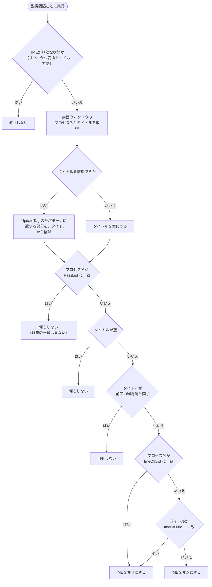

# AlwaysIME 仕様書

2026-10-28 ｜ 対象: 設定ファイルの管理、設定画面、バックアップ、ログ、インストーラーと配布

※ 設定キーの詳細は「AlwaysIME 設定キー一覧」を参照してください。

## 1. 概要

AlwaysIMEは、Windowsのタスクトレイに常駐し、IMEの状態を監視して制御するアプリです。

- IMEの制御モード（オン / オフ / 直前の状態を維持）を設定できます。
- アプリごとに、IMEを操作しない、またはオフにする、を指定できます（制御モードが2のときは、オンにするアプリになります）。
- トレイメニューの「IMEオフに登録」で、前面のアプリやウィンドウタイトルを一覧に追加できます。制御モードが2のときは、「IMEオンに登録」に表示が変わります。
- 一定時間、キーボードやマウスの入力が無いと、IMEの制御状態を復元します。
- MS-IMEのスペースと句読点の入力を、レジストリ経由で切り替えられます（Windows 11の新しいIME専用）。
- 設定のバックアップと復元、動作ログ、自動起動の登録を備えます。
- インストーラー（Inno Setup）、winget、zipで配布します。

### 動作環境と前提

- Windows 10とWindows 11で動作します。.NET 10の対応OSの一覧に載っているWindowsが対象です（一般的なWindows 10 22H2は、載っていません）。
- 実行には、.NET 10 デスクトップ ランタイム（x64）が必要です。
- 「MS-IME入力設定」は、Windows 11の新しいMS-IME専用です。互換モードでは動作しません。ATOKやGoogle日本語入力では動作せず、対応の予定もありません。非対応のIMEを選んでいるときは、パネルの下部に警告を表示します（設定は無効になりません）。
- 管理者権限は不要です（自動起動の登録も、現在のユーザーのみが対象です）。

## 2. 配布物と保存場所

### 配布物（zip）

実行ファイルと同じフォルダーに、次のファイルを置きます。

| ファイル | 役割 |
| --- | --- |
| AlwaysIME.dll.config.default | 初期設定のひな形です。**必須**です。既定値は、このファイルだけが持ちます。 |
| LICENSE.txt | MITライセンスです。 |
| AlwaysIME.portable | 任意です。置くと、初回起動時にポータブルとして動作します（中身は問いません）。 |

**Program Files配下には展開しないでください。** 標準ユーザーはその場所に書き込めないため、設定の変更、ログ、バックアップが保存されません。

### 設定ファイルの場所の決め方

設定ファイルの名前は `AlwaysIME.dll.config` です。利用者に確認はせず、次の順で自動的に決めます。

1. 実行ファイルと同じフォルダーにあれば、**ポータブル**として動作します。
2. 無くて、`%AppData%\AlwaysIME` にあれば、**ユーザー別**として動作します。
3. どちらにも無い初回起動では、`AlwaysIME.portable` があればポータブル、無ければユーザー別で作ります。

既存の設定ファイルがある場合は、マーカーファイルより優先します。

ログの保存先も、同じ方式で決まります（ポータブルは `logs`、ユーザー別は `%AppData%\AlwaysIME\logs`）。バックアップは、設定ファイルと同じ場所の `backup` フォルダーです。

### 書き込めない場所の扱い

| 状況 | 動作 |
| --- | --- |
| マーカーがあるが、実行フォルダーに書き込めない（初回） | ユーザー別で作成し、理由と保存先を通知します。 |
| ポータブルの設定ファイルがあるが、書き込めない | 通知して、起動は続けます。設定の変更、ログ、バックアップは保存されない可能性があります。 |
| 設定画面で保存したときに書き込めない | 場所と理由を表示し、画面は閉じません。 |

## 3. 起動時の処理

1. 保存場所を決めます（ファイルの有無だけで決まります）。
2. ひな形を読み込んで検証します。失敗したら、エラーを表示して終了します。
3. 設定ファイルが無ければ、検証済みのひな形から作成します。
4. バックアップサービスを開始します。設定ファイルがXMLとして壊れていれば、バックアップからの復元、または初期設定での再作成を選べます。
5. 設定ファイルを検証して修復します（不足キーの補完、不正値の置き換え）。
6. 設定値を反映して、常駐を開始します。

すでに起動している状態でもう一度起動すると、2つ目は起動中のプロセスへ再起動のシグナルを送って終了し、起動中のプロセスが再起動します。2つ目は、設定ファイルの補完や置き換えを行いません。

## 4. 設定値の検証と修復

### 基本方針

- **既定値は、ひな形ファイルだけが持ちます。** プログラムのコードには、既定値を持ちません。持つのは、検証ルール（キー、型、範囲）と、「空の状態」だけです。
- ひな形は、起動時に1回だけ読み込んで検証し、以降はメモリ上の値を使います。
- 「リセット」は、ひな形の値に戻すことを指します。アプリ本来の初期値に戻す手段は提供しません。

### ひな形の検証（起動時）

次のいずれかなら、アプリは起動しません。

- ひな形が無い
- XMLとして読めない、または形式が不正
- 必須のキーが不足している
- 値が、検証ルールに合わない
- 同じキーが重複している

画面には、種別、ファイルのフルパス、対象のキー（5件まで）を表示します。ログには、キー名、値、理由を残します。ひな形に未知のキーがあっても、警告のみで無視します。

ひな形は利用者が書き換えられる場所にあります。そのため、誤編集やファイルの欠落（展開ミス、ウイルス対策ソフトによる隔離）でも、このエラーになります。

### 設定ファイルの修復（起動時）

| 状況 | 処理 |
| --- | --- |
| キーが無い（更新で項目が増えた場合など） | ひな形の値で補い、ログに残します。 |
| 値が不正 | そのキーだけひな形の値に置き換え、元の値と理由をログに残します。置き換えがあれば、起動時に1回だけ通知します。 |
| ひな形に無いキー | 変更しません。 |
| 修復を書き込めない | 警告を残して起動を続けます。 |

### 実行中の不正値

起動後に、設定ファイルの手編集やバックアップからの復元で不正値が入った場合は、確認ダイアログを表示します。「初期値にする」を選ぶと、そのキーをひな形の値に書き戻して続行します。「設定を確認」を選ぶと、編集後に再読み込みします。

### リセット

- 拡張設定画面で、キー単位に「リセット」できます。ひな形の値に戻り、「保存して閉じる」または「適用」で反映されます。
- 全体のリセットは、現在は提供していません。

## 5. 設定画面

左のカテゴリー一覧から選びます。

| カテゴリー | 内容 |
| --- | --- |
| 制御しないアプリ | IMEを一切操作しないアプリ（PassList） |
| IME-OFFアプリ（制御モード2では IME-ONアプリ） | 切り替えやタイトルの変化時に、IMEをオフにするアプリ（ImeOffList）。制御モードが2のときは、通常がオフのため、載せたアプリがオンになります |
| IME-OFFタイトルパターン（制御モード2では IME-ONタイトルパターン） | タイトルが一致したらIMEをオフにする正規表現（ImeOffTitle）。制御モードが2のときは、一致したらオンになります |
| タイトル除外タグ | タイトルの変化を判定するとき無視する正規表現（UpdateTag） |
| 未入力タイムアウト | 入力が無い時間（NoKeyInputTime）。画面では秒で入力します。経過すると、IMEを初期状態（オン。制御モード2ではオフ）に戻します。一覧のアプリは、一覧の指定どおりにします。 |
| MS-IME入力設定 | スペース幅、句読点、キー割り当て（変換 / 無変換） |
| 自動起動 | 「スタートアップ」または「タスクスケジューラ」への登録 |
| 上級者向け設定 | 常駐の終了の位置、ダークモード、ログの設定 |
| バックアップ | バックアップの設定、今すぐ作成、復元 |
| 拡張設定 | 全キーの一覧と編集、キー単位のリセット |
| バージョン情報 | バージョン、ライセンス、実行権限（管理者かどうか）、保存場所、最新版へのリンク |

自動起動は、設定ファイルではなく、実際のショートカットとタスクの有無で判断します。2つの方法は同時に使えず、選ばなかった方の登録は削除します。タスクスケジューラは、ログオンの10秒後に起動します。実行ファイルを移動して、前回の登録先のファイルが無くなると、次回の起動時に登録内容を更新します。前回の登録先のファイルが残っているとき（別のコピーを起動したとき）は、登録を付け替えません。その場合、設定画面の自動起動パネルに「登録先は、このAlwaysIMEとは別の場所です。」と表示します。この場所に変えるには、いったん「自動起動しない」を適用してから、選び直します。管理者権限での登録は、通常権限のプロセスからは更新しません。

### 一覧の判定の流れ（制御モード1）

監視間隔（`intervalTime`）ごとに、前面のウィンドウを調べて、次の順で判定します。

複数の一覧に一致したときは、上から順に評価して、最初に一致した一覧で決まります。

| 順位 | 一覧 | 照合する対象 | 照合の方法 | 一致したときの動作 |
| --- | --- | --- | --- | --- |
| 1 | PassList | プロセス名 | 完全一致（大文字小文字を区別しない） | IMEを操作しない。以降の一覧は評価しない |
| 2 | ImeOffList | プロセス名 | 完全一致（大文字小文字を区別しない） | IMEをオフにする。ImeOffTitle は評価しない |
| 3 | ImeOffTitle | タイトル（UpdateTag の削除後） | 正規表現（部分一致、大文字小文字を区別する）。全アプリ共通 | IMEをオフにする |
| － | どれにも一致しない | － | － | IMEをオンにする |

- **PassList が最優先**です。同じアプリが PassList と ImeOffList の両方に載っているときは、PassList が勝ち、IMEを操作しません。
- **ImeOffList と ImeOffTitle の両方に一致**したときは、どちらもオフにするため、結果は同じです。ImeOffList が先に評価され、一致すれば ImeOffTitle は評価しません。
- 制御モード1には、IMEを必ずオンにする一覧はありません。PassList、ImeOffList、ImeOffTitle のどれにも一致しないものが、オンになります。
- **UpdateTag は一致を判定する一覧ではなく、タイトルの前処理**です。設定した正規表現を先頭から順に適用して、一致した部分をタイトルから削除します。削除後のタイトルが、「前回と同じか」の比較と、ImeOffTitle の照合の両方に使われます。そのため、UpdateTag で削除される部分に依存する ImeOffTitle のパターンは、一致しません。
- タイトルが空のウィンドウ（タイトルを取得できないものを含む）は、ImeOffList に載っていても、何もしません。
- 判定は、タイトルが変わったとき（アプリの切り替えを含む）だけ行います。同じタイトルの間は、再判定しません。IMEの切り替えに失敗したときは、前回のタイトルを更新しないため、次の監視で再試行します。
- 未入力タイムアウトで初期状態に戻すときは、PassList を見ずに、ImeOffList、ImeOffTitle の順で判定します（どちらかに一致すればオフ、どちらにも一致しなければオン）。
- 制御モード2では、ImeOffList と ImeOffTitle に一致したときの動作が逆（オン）になり、どれにも一致しないものがオフになります。制御モード3では、どれにも一致しないものは、直前のIMEの状態を維持します。PassList の扱いは、どのモードでも同じです。

## 6. バックアップと復元

- **安定版バックアップ**: 設定を変更してから、アプリが `BackupStableHours`（時間）動作し続けたら、安定動作を確認できたとみなして作成します。設定を試行錯誤している間は作成しません。
- 保持する世代数は `BackupKeep` です。超えた分は、古いものから削除します。
- 「今すぐバックアップ」で、保存済みの設定を手動で保存できます。
- **復元**: 日付と範囲（すべての設定 / アプリ一覧のみ / それ以外の設定のみ）を選びます。復元の前の設定は、別に保存します。
- 設定ファイルが壊れていた場合は、起動時に、バックアップからの復元か、初期設定での再作成を選べます。
- 保存先は、設定ファイルと同じ場所の `backup` フォルダーです。

## 7. ログ

- 出力の有無、レベル（情報 / 警告 / エラー）、1ファイルの最大サイズ、過去ログの数を設定できます。
- ウィンドウタイトルなど、作業内容が分かる情報は記録しません。
- ひな形のエラーなど、設定ファイルの場所が決まる前のログは、決定後に出力します。

## 8. エラーと対処

| 表示 | 原因 | 対処 |
| --- | --- | --- |
| 「設定ファイルに問題が見つかりました。…（ファイルが見つかりません）」 | ひな形が無い | zipを展開し直す。ウイルス対策ソフトの隔離を確認する。 |
| 同上（読み込めません / 形式が不正です） | ひな形を編集して壊した | ひな形を、配布物から入れ直す。 |
| 同上（キーが不足 / 値が不正） | ひな形の編集、または版の不一致 | ひな形を、配布物から入れ直す。ログで、対象のキーを確認する。 |
| 「設定の一部が不正だったため、ひな形の値に戻しました。」 | 設定ファイルの手編集 | 対処は不要です。元の値は、ログに残っています。 |
| 「設定を保存できませんでした。」 | 書き込めない場所 | 書き込める場所へ移動する。 |
| 「設定ファイルに書き込めない…」 | Program Files配下など | 同上。または、設定ファイルを削除して、ユーザー別で使う。 |

画面には、「対処方法がわからない場合は、PCの管理者や、PCの設定に詳しい方にご相談ください。」と表示します。

## 9. 既知の制限

- MS-IME入力設定は、Windows 11の新しいMS-IME専用です。
- 管理者権限で動くウィンドウは、AlwaysIMEを通常のユーザー権限で実行していると反応しません。対応方法は「10. 管理者権限で動くウィンドウへの対応」を参照してください。WinUI / UWPなどのモダンUIフレームワークのアプリには対応していません。
- IME-OFFタイトルパターンなどのリストは、カンマ区切りです。正規表現にカンマを含めたいときは、カンマを \\\\x2C と書きます（例: foo,bar は foo\\\\x2Cbar）。
- 組織のポリシーで、タスクスケジューラへの登録や、IMEのレジストリへの書き込みが制限される場合があります。
- 設定画面で保存した値が不正な場合は、反映時に確認ダイアログが表示されます。「初期値にする」を選ぶと、そのキーがひな形の値に戻ります。IME-OFFタイトルパターンとタイトル除外タグは、正規表現として書式が正しいかも検証し、誤りがあれば不正な値として扱います。
- 制御しないアプリ（PassList）が前面のまま未入力タイムアウトを過ぎると、IMEが初期状態に戻ります。PassListの「IMEを一切操作しない」の例外です。

## 10. 管理者権限で動くウィンドウへの対応

管理者権限で動くウィンドウは、通常のユーザー権限のAlwaysIMEからは操作できません（Windowsの仕様です）。対応するには、AlwaysIMEも管理者権限で実行します。

1. **手動で起動する**: 実行ファイルを右クリックして、「管理者として実行」を選びます。起動のたびに、ユーザーアカウント制御（UAC）の確認が出ます。
2. **ログオン時に自動で起動する**: AlwaysIMEを管理者として起動して、設定画面の「自動起動」で「タスクスケジューラに登録する（管理者権限で実行）」を選びます。タスクは「最上位の特権で実行する」で登録されます。次回のログオンから、UACの確認なしで、管理者権限で起動します。

補足:

- 管理者権限の自動起動は、AlwaysIMEを管理者として起動しているときだけ、登録・変更・解除できます。通常権限で起動しているときは、現在の状態（管理者権限で登録されていること）を表示するだけで、すべての選択肢が無効になります。登録先が通常のユーザー権限で書き換えられる場所にあるときは、登録前に確認が出ます。手動で別の名前のタスクを作ると、AlwaysIMEは検出できません。
- スタートアップフォルダーのショートカットを「管理者として実行」にしても、ログオン時には起動しません（ログも作成されません）。
- 管理者権限で動いている間に、通常権限でもう一度起動すると、再起動のシグナルが届き、管理者権限のまま再起動します。このとき、設定ファイルの変更も反映されます。
- 管理者権限で動いているかは、トレイアイコンのツールチップ（「AlwaysIME（管理者）」）、設定画面のタイトル（「AlwaysIME 設定（管理者）」）、バージョン情報の「実行権限」で分かります。管理者権限で動かすのは、必要な場合に限ってください。
- マニフェストの uiAccess を使う方法は、署名と信頼された場所（Program Filesなど）への配置が必要です。zip配布のポータブルな使い方には合わないため、対象外です。

## 11. インストーラーと配布

### 配布形態

| 形態 | 内容 |
| --- | --- |
| インストーラー | Inno Setup。`AlwaysIME-バージョン-x64-setup.exe`。GitHub Releasesで配布します |
| winget | 上のインストーラーを、wingetのマニフェストから参照します。パッケージIDは `jarupxx.AlwaysIME` です |
| zip | 展開するだけで使えます。`AlwaysIME.portable` を置くと、ポータブルとして動作します |

x64のみです。ARM64のWindows 11では、x64のエミュレーションで動作します。

### インストーラーの動作

- **権限とインストール先**: 既定は、現在のユーザーだけに入れます（管理者権限は不要。`%LOCALAPPDATA%\Programs\AlwaysIME`）。画面の選択、またはコマンドラインの `/ALLUSERS` で、全ユーザー向け（Program Files）にできます。
- **含めないファイル**: `AlwaysIME.dll.config`（利用者の設定）、`AlwaysIME.portable`（あると、ポータブル動作になるため）、`*.pdb`。
- **設定とログ**: インストール先に `AlwaysIME.dll.config` も `AlwaysIME.portable` も無いため、初回起動で、ユーザー別（`%AppData%\AlwaysIME`）として作られます。更新でも、アンインストールでも、消しません。
- **更新（上書き）**: ファイルをコピーする前に、起動中のAlwaysIMEを `--exit` で正常に終了させます。終了できないときは、インストールを中止して、手動で終了するよう案内します。更新後は、対話式なら、最後の画面で起動を選べます。サイレントなら、更新前に起動していた場合だけ、起動し直します。
- **ランタイムの確認**: .NET 10 デスクトップ ランタイム（x64）が見つからないときは、対話式なら警告して、続けるかを確認します。サイレントなら、何も表示せず続けます（wingetでは、依存パッケージとして先に入ります）。
- **アンインストール**: `--exit` で終了させて、`--remove-autostart` で自動起動の登録を解除します。管理者権限で登録された自動起動は、解除できません。
- **強制終了をしない理由**: 終了時に、MS-IMEのスペース、句読点、キー割り当てを元に戻すためです。強制終了をすると、戻らないことがあります。
- **AppId**: バージョンが変わっても、変えません。変えると、別のアプリとして扱われ、更新できなくなります。

### コマンドライン引数

インストーラーなどの管理用です。どちらも、常駐は開始しません。

| 引数 | 動作 | 終了コード |
| --- | --- | --- |
| `--exit` | 起動中のAlwaysIMEに、終了を要求します。確認は出さず、メニューの「常駐の終了」と同じ後始末をして終了します。同じセッションのプロセスが終了するまで、最大20秒待ちます。起動していなければ、何もしません | 0: 終了した、または起動していない / 1: 終了を確認できなかった |
| `--remove-autostart` | 自動起動（スタートアップ、タスクスケジューラ）の登録を解除します | 0: 解除した / 1: 解除できなかった（管理者権限で登録されている場合など） |

終了の要求は、名前付きイベント（`AlwaysIME_ExitSignal`）で届きます。再起動の要求（`AlwaysIME_RestartSignal`）と同じ仕組みです。

### wingetのマニフェスト

| 項目 | 値 |
| --- | --- |
| PackageIdentifier | `jarupxx.AlwaysIME` |
| InstallerType | `inno`（サイレント用のスイッチは、wingetが自動で付けます） |
| Scope | `user` |
| 依存パッケージ | `Microsoft.DotNet.DesktopRuntime.10` |
| ProductCode | `{AppId}_is1` |
| 保存場所 | `winget\manifests\j\jarupxx\AlwaysIME\<バージョン>\`（version、installer、defaultLocale（en-US）、locale（ja-JP）の4ファイル） |

### リリースの手順

1. `AlwaysIME.csproj` の `VersionPrefix` を更新します。
2. `installer\build.ps1` を実行します。`dotnet publish` のあと、インストーラーを作り、SHA256を表示します。
3. インストーラーを、GitHub Releasesにアップロードします。
4. マニフェストの `PackageVersion`、`InstallerUrl`、`InstallerSha256`、`ReleaseNotesUrl` を更新します。`wingetcreate update jarupxx.AlwaysIME --version <バージョン> --urls <URL>` で、ハッシュも含めて更新できます。
5. `winget validate <マニフェストのフォルダー>` で書式を確認し、`winget install --manifest <マニフェストのフォルダー>` で、インストールを試します（ローカルのマニフェストを使うには、`winget settings --enable LocalManifestFiles` が必要な場合があります）。
6. `microsoft/winget-pkgs` にプルリクエストを送ります。
